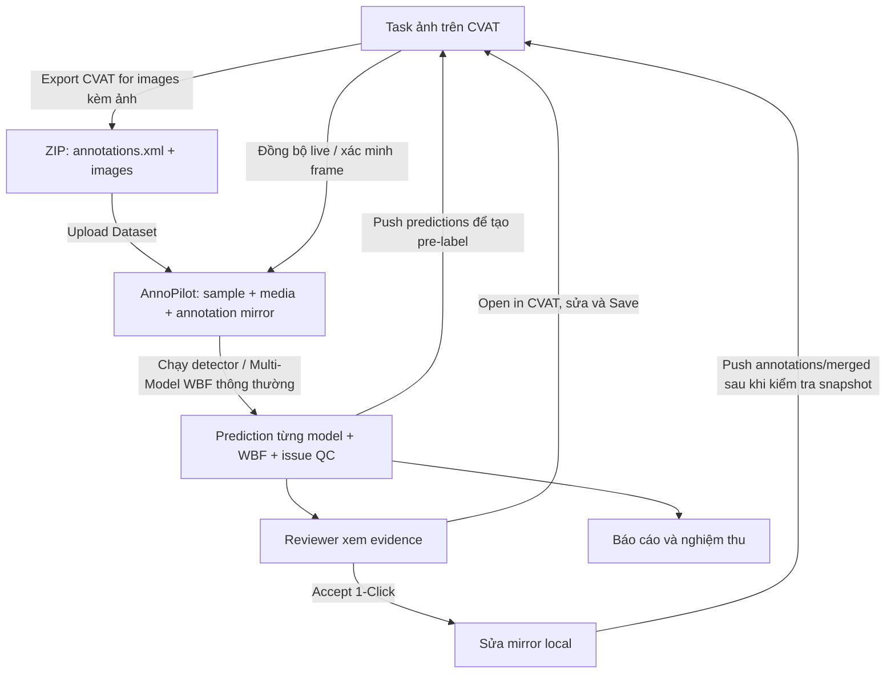

# CVAT ↔ AnnoPilot: nhập dữ liệu, trích xuất nhãn và đồng bộ hai chiều

Cập nhật theo code ngày 15/10/2026. Luồng chính được kiểm tra cho **ảnh và bounding box 2D không xoay**. Phần “project” bên dưới là ứng dụng AnnoPilot; **Project trên CVAT** là nhóm chứa các Task và taxonomy, không phải ID dùng thay cho Task ID.

## 1. Kết luận về luồng hiện tại

Có hai việc khác nhau:

1. **Nhập dataset lần đầu:** export annotation + ảnh từ CVAT rồi upload vào AnnoPilot. Hiện chưa có chức năng nhập Task ID để tự tải toàn bộ dataset/ảnh qua API.
2. **Đồng bộ nhãn sau đó:** khi dataset/sample đã tồn tại, AnnoPilot gọi REST API CVAT để đọc nhãn mới nhất hoặc đẩy box về Task/Job đã cấu hình. Sync không tự tải ảnh, tạo Task hay tạo thêm sample.

CVAT giữ annotation chính. AnnoPilot lưu bản sao annotation, prediction từng model, box WBF và issue QC. Chạy model/WBF hoặc Accept local **chưa tự ghi lên CVAT**; phải bấm push hoặc sửa trực tiếp trên CVAT.



## 2. CVAT → AnnoPilot: nhập lần đầu

### Bước 1 — Chuẩn bị Task trên CVAT

- Tạo/chọn Task ảnh và labels đúng taxonomy. Task có thể thuộc một CVAT Project.
- Giữ nguyên tên ảnh; không resize ảnh riêng cho AnnoPilot nếu vẫn dùng tọa độ annotation của ảnh gốc.
- Save annotation hiện tại trên CVAT. Nếu Task chưa có nhãn, file export vẫn cần record cho từng ảnh để AnnoPilot tạo sample.

### Bước 2 — Export dữ liệu

Chọn định dạng **CVAT for images / CVAT images XML** (tên phiên bản tùy CVAT đang dùng), bật kèm ảnh khi giao diện export có tùy chọn đó. Kiểm tra ZIP có cấu trúc tương ứng:

```text
task-export.zip
├── annotations.xml
└── images/
    ├── a.jpg
    └── b.jpg
```

Nếu export chỉ có XML, lấy thêm đúng bộ ảnh của Task và giữ nguyên tên/đường dẫn. Không dùng task backup ZIP như một định dạng import dataset được mặc định hỗ trợ.

### Bước 3 — Upload vào AnnoPilot

`Upload Dataset → đặt tên → Annotation format = CVAT hoặc Auto Detect → chọn ZIP vào Annotation files / ZIP → Upload & Analyze`.

Nếu ZIP đã chứa XML + ảnh, backend lấy cả ảnh trong ZIP khi không tải media riêng. Hoặc upload `annotations.xml` ở phần annotation, bộ ảnh/ZIP ảnh ở phần media.

Backend đọc các record `<image>` và box, ghép media theo đường dẫn/tên, kiểm tra kích thước rồi lưu vào database/upload storage. Sample không ghép được media vẫn có thể có nhãn nhưng không inference được ảnh; phải xử lý cảnh báo media trước khi demo.

### Bước 4 — Cấu hình kết nối

Trong `Model QC → Công cụ khác → Cấu hình kết nối CVAT`:

| Trường | Nhập gì |
|---|---|
| Base URL | Domain/server CVAT, ví dụ `https://cvat.example`; backend AnnoPilot phải truy cập được địa chỉ này. |
| Task ID | ID của Task chứa đúng bộ ảnh. Không dùng CVAT Project ID. |
| Job ID | Tùy chọn. **Để trống để sync toàn Task.** Chỉ điền nếu mọi sample trong dataset thuộc Job đó. Job ID khác Segment ID. |
| PAT | Token của tài khoản có quyền đọc/ghi Task tương ứng. |

Lưu cấu hình không tự tải ảnh hoặc chạy model. Khi đọc/ghi live, backend kiểm tra metadata, tên ảnh/kích thước và phạm vi Job; dữ liệu không khớp sẽ bị từ chối trước khi sửa nhãn.

## 3. Cách chuyển đổi và ghép dữ liệu

| Dữ liệu CVAT | Dữ liệu AnnoPilot / quy tắc |
|---|---|
| `<image name>` | `Sample.file_name`, dùng để ghép media và file sync. |
| `<image id>` | Frame ID ban đầu của XML. Live sync/push kiểm tra lại tên ảnh với metadata server, không tin vào chữ số bất kỳ trong filename. |
| `xtl, ytl, xbr, ybr` hoặc REST `points[4]` | Tọa độ pixel `x1, y1, x2, y2`; không phải tọa độ YOLO normalized. |
| CVAT `label_id` | Tra tên class qua label schema; push map ngược tên → ID của Task đích. ID class YOLO không phải CVAT label ID. |
| Attributes | Live sync chuyển spec ID thành tên thuộc tính trong mirror; push map tên sang spec ID của label đích khi có schema tương ứng. Các key nội bộ QC không tự trở thành CVAT attributes. |
| Shape ID | Lưu ở source metadata khi đọc live để giữ dấu vết nguồn; khác với Annotation ID local. |

Label schema được đọc qua các trang pagination. Một số tên tương đương như person/pedestrian có mapping; tên không map được báo lỗi, không gán vào label bất kỳ. Khi có tên file trùng ở nhiều thư mục, cần giữ đường dẫn đủ để ghép duy nhất.

Đối với image task, metadata Task là căn cứ ghép tên ảnh và frame; kích thước khác nhau bị từ chối. Với video, cần frame ID rõ ràng; luồng video/tracks chưa được chứng nhận end-to-end cho MVP này.

## 4. CVAT → AnnoPilot: cập nhật nhãn đã sửa

### A. Đồng bộ live toàn dataset hiện có

1. Reviewer sửa box/class trên CVAT và **Save**.
2. AnnoPilot: bấm **Đồng bộ từ CVAT**.
3. **Không chọn file**, xác nhận đồng bộ.
4. Backend đọc metadata/labels/annotations live; thay annotation mirror của các sample hiện có theo CVAT, cập nhật frame mapping và chạy lại QC bằng prediction đã lưu.
5. Issue phù hợp được đối soát; UI hiển thị số frame cập nhật và cảnh báo còn lại.

Ảnh không có box trên CVAT được coi là một frame rỗng hợp lệ, sau khi tên/frame đã được xác minh. Không có warning chỉ nghĩa là không còn nghi vấn theo cấu hình hiện tại, không tự chứng minh ảnh đúng hết.

### B. Xác minh một frame

Sau khi Save trên CVAT, chọn frame trong AnnoPilot → **Kiểm tra & Đồng bộ từ CVAT**. Nút này đọc live và đối soát. Nếu API/token lỗi thì báo lỗi, không dùng một file cũ để giả lập xác minh.

Nút **Đã sửa (ghi nhận thủ công)** là khai báo của người dùng; không thay thế việc đọc nhãn live. Lịch sử phân biệt thao tác người dùng và đối soát live/file qua ghi chú.

### C. Nạp snapshot thủ công

Chọn `Đồng bộ từ CVAT` và tải **CVAT XML** hoặc **BDD100K JSON** đã export. Nếu có ZIP thì giải nén và lấy XML; modal sync hiện không nhận ZIP. Không mặc định mọi JSON của CVAT/COCO đều được hỗ trợ trong nút này.

File sync chỉ cập nhật sample có tên khớp; không ghép nhầm một ảnh khác chỉ vì trùng frame ID. File rỗng/không có record/malformed/shape không hỗ trợ bị từ chối. Frame bị bỏ khỏi file không được tự hiểu là cần xóa nhãn; muốn xóa nhãn của một frame, phải có record ảnh đó với annotation rỗng.

File là snapshot tại thời điểm export, **không phải xác minh live**. Pull live/file thay mirror của các frame được sync; thay đổi local chưa push có thể bị thay thế.

## 5. AnnoPilot → CVAT: chọn đúng nguồn dữ liệu

Vào **Đẩy nhãn sang CVAT**, chọn nguồn và chế độ rồi xác nhận.

| Nguồn | Thực tế gửi lên CVAT | Khi nên dùng |
|---|---|---|
| `predictions` | Pre-label WBF khi đã chạy fusion và có provenance hợp lệ. Nếu chỉ một detector active thì có thể gửi nguồn đó. Nhiều nguồn chưa WBF hoặc WBF chứa nguồn inactive bị từ chối; không gửi mọi box của mọi model chồng lên nhau. | Task mới/chưa gán nhãn, cần AI đề xuất box để người sửa. |
| `annotations` | Bounding box trong mirror local hiện tại, gồm cả chỉnh sửa do Accept. | Muốn chuyển snapshot nhãn local đã kiểm tra sang CVAT. |
| `merged` | Mirror local + Missing Object đã ACCEPTED/RESOLVED nếu chưa có annotation tương ứng. Không đưa issue PENDING/REJECTED/FALSE_POSITIVE vào nhãn. | Muốn bổ sung các gợi ý đã duyệt, giữ nhãn local hiện có. |

Không gửi QC Score, evidence, Tier hoặc issue overlay thành annotation chính thức. Chưa có push issue/evidence tự động trực tiếp vào CVAT.

### Append / Create

Gọi `PATCH .../annotations?action=create`, bổ sung box mới và bỏ box trùng chính xác theo frame/class/tọa độ đã làm tròn. **Không cập nhật hoặc xóa box cũ.** Chưa có chống trùng nâng cao cho nhiều worker đồng thời hoặc box gần giống đã sửa bằng tay.

Nếu Accept local đổi class car → bus mà CVAT còn box car cũ tại cùng vị trí, append hiện bị chặn để tránh tạo thêm box bus bên cạnh box car. Hãy sửa class trực tiếp trên CVAT rồi pull về, hoặc dùng Replace với snapshot đã kiểm tra.

### Replace

Gọi `PUT .../annotations`: thay **rectangle không xoay trên các frame thuộc dataset local**, giữ shape thuộc frame khác, shape khác loại/rotation và tags. Payload mang version lấy từ server. Dataset có một phần Task không còn làm mất nhãn ở phần Task nằm ngoài dataset.

Replace có thể xóa các rectangle trên frame được chọn nếu snapshot frame đó không còn box. Không dùng khi chưa kiểm tra snapshot; không có cơ chế merge tự động giữa hai reviewer sửa đồng thời. Replace bị từ chối khi CVAT có video tracks để tránh giữ track rồi đồng thời tạo box tĩnh trùng với track.

**Thứ tự nếu sửa ở AnnoPilot:** pull nhãn mới nhất → Accept/sửa local → kiểm tra snapshot và bảo đảm không có sửa đổi CVAT mới chưa được xử lý → push → mở CVAT kiểm tra → pull/verify lại. Không pull đè lên bản local vừa Accept mà chưa push nếu muốn giữ các chỉnh sửa đó.

## 6. WBF thông thường và thử nghiệm nhiễu là hai nơi lưu khác nhau

- **Chạy Inference & WBF thông thường:** lưu vào Prediction của dataset; nguồn fused này được nút push `predictions` sử dụng.
- **Thử nghiệm WBF sáu cấu hình có nhiễu:** lưu report riêng dưới `.runtime/wbf-experiments`; không sửa Prediction/Annotation vận hành. Báo cáo JSON tải xuống không phải CVAT annotation export.

Hiện chưa có nút chọn một nhánh perturbation trong report rồi push trực tiếp sang CVAT. Muốn đưa pre-label lên CVAT trong luồng MVP hiện tại, chạy WBF thông thường rồi push nguồn `predictions`. Không khẳng định kết quả thí nghiệm đã được đồng bộ chỉ vì report tồn tại.

## 7. Quy trình demo đề xuất cho team

| Bước | Thao tác | Phụ trách |
|---|---|---|
| 1 | Chuẩn bị Task ảnh/labels, export XML + ảnh; xác nhận đúng Task/Job | Tuấn Minh |
| 2 | Kiểm tra dataset/annotation đầu vào và nhập vào AnnoPilot; giữ Golden riêng | Lâm Bách |
| 3 | Cấu hình CVAT, kiểm tra mapping; chạy WBF thông thường trên 1–3 ảnh có media | Quang Minh; Tuấn Minh kiểm tra frame |
| 4 | Push `predictions` để tạo pre-label trên Task demo, hoặc review issue của bộ nhãn hiện có | Quang Minh thao tác; Bách kiểm box |
| 5 | Sửa một class hoặc bổ sung box trên CVAT và Save | Tuấn Minh |
| 6 | Pull live/verify về AnnoPilot; kiểm tra label/box/issue đúng ảnh | Bách QA; Quang Minh hỗ trợ lỗi |
| 7 | Lưu bằng chứng request/kết quả không kèm PAT; ghi version và các giới hạn còn lại | Bách viết testing docs; Tuấn Minh dùng để quay video |

Chỉ dùng Task demo có dữ liệu được phép chỉnh sửa. Kiểm thử tự động của thay đổi này dùng một CVAT giả lập có trạng thái; **chưa xác nhận round-trip trên server CVAT thật của team**, chưa thực hiện push lên server của team trong lượt kiểm tra này.

Kết quả kiểm tra phần mềm: **103 backend tests pass**, TypeScript/Vite build thành công tại `.runtime/build-cvat-final-a`. Kiểm thử giả lập bao gồm push → sửa trên remote → pull → retry, metadata/frame mapping, labels phân trang, attributes, Replace một phần Task và các trường hợp bị từ chối. Chưa có kiểm thử trình duyệt tự động trong lượt này.

## 8. Các điểm đã sửa khi rà soát

- Segment ID không còn được dùng nhầm làm Job ID; chỉ nhận Job từ metadata/URL chỉ rõ job.
- Không tự chuyển Task sang job đầu tiên; có thể xóa Job ID trong cấu hình để trở lại Task scope.
- Đọc/ghi live kiểm tra tên ảnh/kích thước/phạm vi Job; sửa frame mapping thay vì đoán từ filename.
- XML không có `<?xml ...?>` vẫn được nhận diện; file rỗng không bị hiểu là yêu cầu fallback gọi live.
- File sync không ghi đè ảnh khác chỉ vì trùng số frame; lỗi input trả 422, lỗi kết nối server trả 502.
- Label pagination và attributes live được chuẩn hóa; không đưa list attributes vào chỗ xử lý cần dict.
- Append không âm thầm tạo box class mới khi box class cũ vẫn còn; Replace giữ frame ngoài phạm vi và từ chối round-trip tracks.
- Push pre-label loại nguồn inactive/synthetic, yêu cầu WBF nếu có nhiều detector chưa fusion.

## 9. API và nguồn đối chiếu

| API AnnoPilot | Vai trò |
|---|---|
| `POST /api/datasets/upload` | Tạo dataset từ file/ZIP và media. |
| `PUT /api/datasets/{id}/cvat-config` | Lưu/clear cấu hình Task/Job/PAT. |
| `POST /api/datasets/{id}/qc/cvat-sync` | Không có file: pull live; có file: nạp snapshot nhãn. |
| `POST /api/datasets/{id}/qc/frame/{sample_id}/cvat-verify` | Đọc nhãn live và đối soát frame. |
| `POST /api/datasets/{id}/qc/cvat-push` | Chuyển nhãn/pre-label local thành rectangle và push REST API. |

Nguồn code: `services/pipeline.py`, `parsers/__init__.py`, `services/cvat_api.py`, các hàm CVAT trong `services/qc_engine.py`, `routers/api.py` và `ModelQCPage.tsx`.

Tài liệu CVAT chính thức: [CVAT for image và cấu trúc ZIP/XML](https://docs.cvat.ai/docs/dataset_management/formats/format-cvat/), [Task API](https://docs.cvat.ai/docs/api_sdk/sdk/reference/apis/tasks-api/), [Job API](https://docs.cvat.ai/docs/api_sdk/sdk/reference/apis/jobs-api/), [DataMetaRead](https://docs.cvat.ai/docs/api_sdk/sdk/reference/models/data-meta-read/), [PAT Bearer authentication](https://docs.cvat.ai/docs/api_sdk/access_tokens/).
