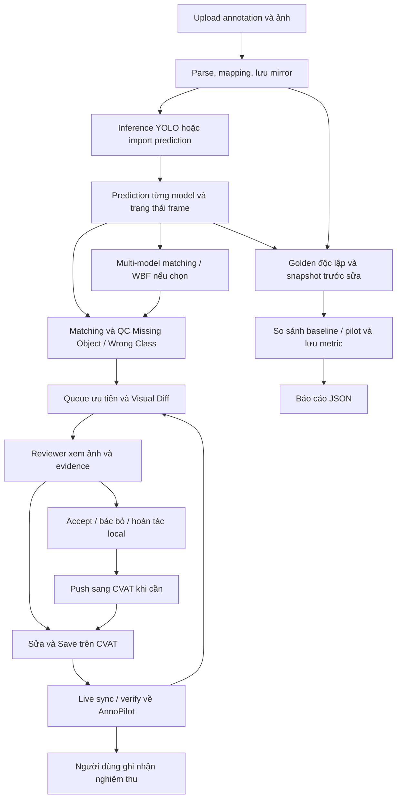

# AnnoPilot MVP — Chức năng, cách sử dụng và luồng vận hành

Ngày đối chiếu: **15/10/2026**. Mã nguồn tham chiếu: commit `c56b965` của AnnoPilot, cùng các file hiện có trong workspace.

Tài liệu được lập bằng cách đọc frontend, API, service và schema hiện tại; **chưa chạy lại ứng dụng, inference, kiểm thử CVAT hoặc tests trong lượt kiểm kê này**. “Có” bên dưới nghĩa là đã có đường xử lý trong code; điều kiện dữ liệu, weights và CVAT vẫn phải được chuẩn bị để vận hành thực tế.

## 1. Mục đích và các khái niệm

AnnoPilot hỗ trợ reviewer tìm **nghi vấn sót vật thể (Missing Object)** và **nghi vấn sai class (Wrong Class)** trên annotation bounding box 2D. Model đề xuất bằng chứng; reviewer quyết định. CVAT giữ annotation chính, AnnoPilot giữ bản sao local (mirror), prediction, issue và lịch sử đánh giá.

| Khái niệm | Ý nghĩa khi sử dụng |
|---|---|
| Dataset / sample | Bộ dữ liệu / một ảnh hoặc frame trong bộ dữ liệu. |
| Annotation | Nhãn hiện có cần QC. Một số nút gọi là GT/Ground Truth, nhưng đây không mặc nhiên là nhãn đúng đã kiểm chứng. |
| Prediction | Box, class và confidence do detector tạo hoặc được nạp từ JSON. |
| Candidate / issue | Vùng nghi vấn / cảnh báo QC cần reviewer xem xét. |
| Fused prediction | Prediction đại diện sau ghép box nhiều model, phục vụ pre-label. |
| Golden Benchmark | Bản nhãn kiểm chứng độc lập dùng đánh giá; khác với annotation đang cần QC. |
| QC Score / severity | Điểm ưu tiên và mức HIGH/MEDIUM/LOW; không phải xác suất nhãn sai đã calibration. |
| Tier | Loại bằng chứng đồng thuận/bất đồng model; khác với severity. |

## 2. Chuẩn bị và mở ứng dụng

Tại thư mục gốc `AnnoPilot-qminh`, dùng PowerShell:

```powershell
.\Start-AnnoPilot.ps1 -Install
```

Các lần sau dùng `.\Start-AnnoPilot.ps1`. Mở UI ở `http://localhost:3000`; Swagger ở `http://localhost:8000/docs`; API health ở `http://localhost:8000/api/health`.

Để inference trực tiếp, cài thêm dependencies model:

```powershell
.\backend\.venv\Scripts\python.exe -m pip install -r backend/requirements-models.txt
```

Cần checkpoint YOLO26 chính thức tại `backend/models/yolo26n.pt` hoặc `yolo26s.pt`; triad cần thêm Faster R-CNN và RT-DETR. Faster R-CNN có thể cần tải weights lần đầu. Xem hướng dẫn tải trong `README.md`. Runtime chọn CUDA nếu PyTorch hỗ trợ, nếu không chạy CPU. Môi trường được ghi nhận trong báo cáo phần cứng hiện là CPU.

Nếu chỉ nạp prediction JSON đã chạy ở nơi khác, API cơ bản không cần toàn bộ runtime inference. Inference thất bại không được thay bằng prediction giả.

## 3. Bản đồ màn hình

Sidebar hiện có **Home, Model QC, Dataset, Dashboard, Settings**. Thanh đầu trang có bộ chọn dataset và nút upload. Sidebar có thể thu gọn, hỗ trợ `Ctrl+B` / `Cmd+B` khi không nhập liệu.

Home và Settings dùng được khi chưa có dataset. Các trang dữ liệu yêu cầu upload/chọn dataset; lỗi kết nối backend được tách khỏi trạng thái chưa có dữ liệu.

| Màn hình | Vai trò hiện tại |
|---|---|
| Home | Giới thiệu workflow, mở upload và chuyển sang dữ liệu/dashboard. Nội dung giới thiệu cần được đối chiếu với khả năng thực tế bên dưới. |
| Dataset | Duyệt sample, xem annotation/media và xóa dataset. Một số bộ lọc/chỉ số độ khó còn là giao diện cũ. |
| Model QC | Khu vực nghiệp vụ chính: inference, queue, WBF, review, CVAT, Golden và nghiệm thu. |
| Dashboard | Có thống kê số sample, số annotation, class và thiếu media; các chỉ số độ khó chưa có dữ liệu tính thật trong backend hiện tại. |
| Settings | Đổi theme/font; có giao diện cấu hình scoring cũ nhưng backend hiện chỉ lưu config. |

## 4. Quản lý và xem dữ liệu

### 4.1. Upload dataset và chuẩn hóa annotation

**Cách dùng:** `Upload Dataset` → nhập tên → chọn Annotation type và Annotation format hoặc `Auto Detect` → chọn annotation/XML/JSON/TXT/ZIP → chọn ảnh/media/ZIP → `Upload & Analyze`.

**Xử lý:** Kiểm tra file/ZIP → nhận diện format → parse annotation → ghép media theo đường dẫn/tên/stem → kiểm tra ảnh/kích thước → lưu dataset, sample, annotation và warnings. Tên sample trùng hoặc format/task không phù hợp sẽ bị từ chối. Hiện nút có chữ “Analyze” nhưng pipeline import không còn tính difficulty.

| Format | Khả năng đọc hiện có | Cách chọn / Giới hạn |
|---|---|---|
| CVAT images XML | Box, polygon, points | Chọn CVAT hoặc Auto; dùng box 2D cho Model QC. |
| COCO JSON | Box, polygon, keypoint | Chọn COCO hoặc Auto; đọc format không đồng nghĩa có QC chuyên biệt cho mọi shape. |
| BDD100K JSON | Box 2D | Chọn Auto Detect; dropdown chưa có lựa chọn BDD100K riêng. API có thể chỉ định BDD100K. |
| YOLO TXT | Detection box 2D | Cần ảnh khớp để quy đổi tọa độ; chuẩn bị mapping class/classes.txt phù hợp. |
| KITTI TXT | Cuboid metadata/geometry | Có parser; không có detector QC 3D, giải mã point cloud hoặc viewer 3D đầy đủ. |

JPG/JPEG/PNG phục vụ hiển thị/inference. BIN/PCD được giữ như file sensor, không được giải mã thành point cloud. Upload annotation-only có thể dùng để xem nhãn, nhưng inference ảnh cần media hợp lệ. Upload ảnh trống đơn thuần chưa phải luồng tạo dataset riêng: endpoint hiện yêu cầu file annotation chứa sample.

### 4.2. Chọn và duyệt dataset

**Cách dùng:** Chọn bộ dữ liệu ở thanh đầu trang → vào `Dataset` → tìm theo tên file → bấm hàng sample để mở chi tiết. Có phân trang, lọc task và các lựa chọn sắp xếp.

**Kết quả:** Xem tên, loại annotation, số nhãn, media và hình học annotation. Viewer có phần hiển thị box/polygon/points; dữ liệu 3D không có viewer chuyên sâu. Các cột difficulty/rare class và bộ lọc tương ứng còn từ phiên bản cũ, không có kết quả phân tích thật hiện tại; nên dùng Model QC để ưu tiên review.

### 4.3. Xóa dataset

**Cách dùng:** `Dataset → Delete Dataset` → xác nhận. Backend xóa bản ghi dataset và thư mục upload liên quan. Đây là xóa dữ liệu local; không phải thao tác xóa Task trên CVAT.

## 5. Inference, queue và prediction

### 5.1. Chọn baseline YOLO26

**Cách dùng:** `Model QC → YOLO → YOLO26n hoặc YOLO26s`.

Lựa chọn được lưu trong browser, dùng cho Queue, kiểm tra lại frame, detector batch và nhánh YOLO của triad. Chỉ dùng một biến thể YOLO mỗi lần; prediction cũ giữ model ID gốc, không đổi tên YOLOv8 thành YOLO26. Chọn n để thử tốc độ, chọn s để thực nghiệm chất lượng; chưa có benchmark thật khẳng định s tốt hơn n trên bài toán này.

### 5.2. Chạy Queue QC theo frame

**Cách dùng:** Chọn dataset có ảnh → chọn YOLO → `Chạy Queue QC` → theo dõi thanh tiến trình → có thể `Tạm dừng` và `Tiếp tục`.

**Xử lý:** Worker nền xử lý từng frame; tạo/tái sử dụng prediction hợp lệ theo nguồn → QC đối chiếu nhãn → lưu prediction/issue → UI lấy trạng thái bằng polling để cập nhật dần. Có trạng thái IDLE/RUNNING/PAUSED/COMPLETED/ERROR, số frame đã xử lý và thông tin lỗi.

Đây là cập nhật tăng dần trong AnnoPilot. **Chưa tự push annotation/issue vào CVAT sau từng frame.** Trạng thái queue nằm trong RAM; chưa có resume bền vững qua backend restart, dù các kết quả đã commit vào database vẫn được lưu.

### 5.3. Kiểm tra lại một frame

**Cách dùng:** Chọn ảnh trong hàng đợi → bấm nút kiểm tra lại frame cạnh tiêu đề ảnh. UI yêu cầu inference lại bằng YOLO đang chọn rồi tải lại chi tiết/QC.

Phù hợp khi cần xem lại một frame sau thay đổi; không phải chạy lại toàn bộ dataset. Inference vẫn cần ảnh và weights thực.

### 5.4. Chạy detector batch

**Cách dùng:** `Công cụ khác → Chạy Detector Batch (Cũ)`.

Có endpoint chạy detector trên dataset bằng YOLO đã chọn. Đây là đường thao tác cũ còn được giữ; ưu tiên Queue để theo dõi tiến độ theo frame. Không có training model trong thao tác này.

### 5.5. Nạp prediction JSON từ bên ngoài

**Cách dùng:** `Công cụ khác → Upload Predictions JSON` → nhập nguồn model → chọn file JSON → upload.

Prediction được ghép với sample theo `file_name`; mỗi box có label, confidence và tọa độ pixel x1/y1/x2/y2. Lần nạp mới thay prediction của cùng nguồn trên các frame được cung cấp. Frame xử lý thành công nhưng không có detection cần bản ghi `predictions: []` để ghi nhận coverage; không bỏ frame đó khỏi file.

Ví dụ cấu trúc JSON (tọa độ chỉ minh họa):

```json
{
  "source_model": "yolo26n",
  "predictions": [
    {
      "file_name": "frame_000001.jpg",
      "checkpoint": "yolo26n.pt",
      "inference_seconds": 0.12,
      "predictions": [
        {"label": "car", "confidence": 0.91, "geometry": {"x1": 100, "y1": 120, "x2": 250, "y2": 220}}
      ]
    },
    {"file_name": "frame_000002.jpg", "predictions": []}
  ]
}
```

## 6. Nhiều model, fusion và bằng chứng QC

**Bổ sung sau kiểm kê ngày 15/10:** Trong modal Multi-Model WBF hiện có panel thử nghiệm inference thật với Gaussian/độ sáng/blur, sáu cấu hình đối chiếu, chạy nền, lịch sử và tải prediction từng lượt. Xem [hướng dẫn thử nghiệm](wbf-perturbation-experiment.md). TTA trong queue mặc định vẫn chưa có; bảng giới hạn bên dưới được hiểu theo phạm vi vận hành đó.

### 6.1. Chạy triad inference trên máy

**Cách dùng:** `Multi-Model WBF` hoặc `Công cụ khác → Inference Bộ 3 Phương Án B (Triad)` → chọn thử 10 frame, 30 frame hoặc toàn bộ → `Chạy Inference & WBF Phương Án B`.

Cấu hình gồm YOLO26 đã chọn, Faster R-CNN MobileNetV3 và RT-DETR-l. Cần đủ thư viện và weights; chạy CPU có thể lâu. Backend lưu prediction/QC tăng dần theo frame. Chạy thử một phần dataset không chứng minh coverage toàn bộ.

### 6.2. Fusion từ prediction đã có

**Cách dùng:** Mở `Multi-Model WBF` → chọn nguồn model → chỉnh weight, IoU ghép candidate, ngưỡng confidence và confidence đồng thuận cao → chạy WBF. Có phần nạp thêm prediction của nguồn mới và fusion lại.

**Xử lý:** Ghép prediction theo không gian, không bắt buộc cùng class → mỗi model có tối đa một phiếu trong candidate → chọn class theo tổng weight × confidence → fusion tọa độ từ detection bỏ phiếu cho class được chọn → lưu nguồn ensemble và chạy audit nếu được yêu cầu.

QC vẫn đọc prediction gốc và candidate không được chọn. WBF phục vụ pre-label, không thay thế quyết định của reviewer. Đổi tên cùng một checkpoint thành nhiều nguồn không tạo thành kiểm chứng model độc lập.

### 6.3. Phân tầng bằng chứng

| Tier | Ý nghĩa mặc định | Thao tác của reviewer |
|---|---|---|
| 1 | Ít nhất hai model cùng class; min confidence ≥ 0,85; average pairwise IoU ≥ 0,60 | Kiểm tra ảnh trước khi chấp nhận; đồng thuận cao vẫn có thể sai. |
| 2 | Prediction matched về cùng đối tượng nhưng bất đồng class | Xem từng model, annotation hiện tại và ảnh để quyết định class. |
| 3 | Chỉ một model phát hiện hoặc đồng thuận chưa đạt Tier 1 | Kiểm tra khả năng vật thể bị bỏ sót hoặc detection giả. |

### 6.4. Phát hiện hai loại lỗi

- **Missing Object:** Prediction/candidate đủ điều kiện nhưng không có annotation phù hợp tại vùng đó. Candidate bị fusion loại vẫn có thể tạo cảnh báo.
- **Wrong Class:** Annotation và prediction matched theo không gian nhưng khác class; ở chế độ nhiều model, bất đồng vẫn được giữ dù annotation trùng class mà fusion chọn.

Ngưỡng QC mặc định trong schema: match IoU 0,50; missing max IoU 0,20; missing confidence 0,40; wrong-class confidence 0,45; min box area 100 px². Một số cấu hình sâu được gửi qua API, chưa có một màn hình chỉnh đầy đủ mọi tham số QC. Ngưỡng confidence trong viewer là lọc hiển thị, không phải tự đổi toàn bộ tham số phát hiện lỗi.

## 7. Review cảnh báo và xem ảnh

### 7.1. Hàng đợi ưu tiên và thống kê

**Cách dùng:** Ở cột trái Model QC, tìm tên ảnh, lọc HIGH/MEDIUM/LOW/CLEAN và Missing Object/Wrong Class → chọn ảnh cần xem.

Hiển thị điểm ưu tiên, số issue, loại lỗi và link CVAT. Trang có thống kê cảnh báo và phần cảnh báo độ phủ: frame chưa chạy/import, frame lỗi inference. Tỷ lệ frame không warning được trình bày kèm giới hạn: **không chứng minh ảnh sạch hoặc thời gian review giảm**.

### 7.2. Visual Diff và bằng chứng từng model

**Cách dùng:** Chọn frame → bật/tắt lớp annotation, prediction và issue → chọn nguồn model hoặc tất cả model → chỉnh ngưỡng confidence hiển thị → zoom +/−, reset, fit và kéo ảnh. Bấm box/card/thumbnail để liên kết vùng ảnh với thẻ issue; có chế độ chữ gọn hoặc đầy đủ.

Thẻ issue cho biết vị trí, class hiện tại/class gợi ý, confidence, IoU, tier và bằng chứng từng model. Khi có candidate evidence, có thể xem model nào đóng góp và model nào không có detection tương ứng. Giao diện này dùng để so sánh; việc sửa hình học annotation chính thực hiện trên CVAT.

### 7.3. Quyết định review và hoàn tác

| Thao tác | Cách dùng | Tác động thực tế |
|---|---|---|
| 1-Click Sửa tự động (Demo) | Bấm trên issue PENDING sau khi kiểm tra | Chuyển ACCEPTED; thêm box thiếu hoặc đổi class trong mirror local. Chưa tự cập nhật CVAT. |
| Báo sai (False Positive) | Bấm khi model cảnh báo sai | Chuyển FALSE_POSITIVE, giữ evidence/lịch sử. UI gửi ghi chú mặc định; API hỗ trợ lý do do người dùng cung cấp. |
| Đã sửa (ghi nhận thủ công) | Bấm để khai báo đã xử lý | Chuyển RESOLVED theo khai báo người dùng; dùng Kiểm tra & Đồng bộ để xác minh nhãn live. |
| Kiểm tra & Đồng bộ từ CVAT | Bấm sau khi Save trên CVAT | Lấy nhãn live của frame, cập nhật mirror, đối soát và giải phóng issue phù hợp; lỗi kết nối được báo ra. |
| Hoàn tác / đưa về chờ | Bấm trên issue đã xử lý | Chuyển PENDING; với sửa local do Accept, xóa box được thêm/khôi phục class trước đó theo metadata của issue. Không hoàn tác tự động dữ liệu đã push sang CVAT. |

Đổi quyết định sau xử lý phải mở lại issue trước. Retry cùng quyết định không được thêm box lần nữa. Các thay đổi tạo review event kèm trạng thái trước/sau, ghi chú và snapshot evidence; API lịch sử có tại `GET /api/samples/{id}/qc/review-history`, chưa có màn hình timeline review chuyên biệt.

### 7.4. Chấp nhận hàng loạt Tier 1

**Cách dùng:** Trong frame đang chọn, dùng nút áp dụng các gợi ý Tier 1 sau khi reviewer kiểm tra. UI gọi batch-resolve của sample; API cũng có batch-resolve cấp dataset.

Thao tác áp dụng quyết định ACCEPTED cho issue PENDING phù hợp, cập nhật mirror. Không phải tự duyệt toàn dataset dựa trên consensus và không thay thế review độc lập.

## 8. Kết nối và trao đổi dữ liệu với CVAT

### 8.1. Cấu hình kết nối

**Cách dùng:** `Model QC → Công cụ khác → Cấu hình kết nối CVAT` → nhập Base URL, Task ID, Job ID khi cần và PAT của người dùng → lưu.

Task/Job phải đúng dataset; kiểm tra mapping filename/frame và taxonomy trước khi sync/push. App không cung cấp token demo mặc định. Việc lưu được cấu hình không đồng nghĩa đã kiểm thử kết nối thành công.

### 8.2. Mở đúng frame trên CVAT

**Cách dùng:** Bấm `Open in CVAT` ở ảnh/issue/hàng đợi → đăng nhập CVAT nếu cần → kiểm tra box/class và sửa → **Save trên CVAT**.

Link dùng URL, Task/Job và frame number. Frame mapping sai sẽ mở sai ảnh, vì vậy cần kiểm tra một vài frame đầu trước demo.

### 8.3. Đồng bộ inbound: CVAT → AnnoPilot

**Cách dùng:** `Đồng bộ từ CVAT` → để trống file để gọi REST API bằng cấu hình đã lưu; hoặc chọn file annotation → xác nhận đồng bộ.

Backend nạp annotation, cập nhật mirror và đối soát lại issue. File sync đọc CVAT XML/BDD100K JSON, gồm XML không có declaration; không mặc nhiên hỗ trợ mọi JSON export của CVAT. File rỗng/không khớp tên ảnh bị từ chối. Đồng bộ bằng file là nhập snapshot, không phải xác minh live. [Luồng hai chiều và mapping](cvat-data-flow.md).

Muốn xác minh một frame sau sửa, dùng `Kiểm tra & Đồng bộ từ CVAT`. Không có fallback sang file cũ khi live/API lỗi.

### 8.4. Push outbound: AnnoPilot → CVAT

**Cách dùng:** `Đẩy nhãn sang CVAT` → chọn nguồn, chế độ và PAT → thực hiện → kiểm tra kết quả trực tiếp trên CVAT.

| Nguồn | Dữ liệu được gửi |
|---|---|
| merged | Annotation local hiện có và bổ sung Missing Object đã ACCEPTED/RESOLVED nếu chưa có annotation tương ứng; không thêm candidate PENDING/REJECTED/FALSE_POSITIVE. |
| predictions | Pre-label từ prediction; ưu tiên fused prediction khi có, tránh gửi đồng thời mọi box của các model. Reviewer vẫn phải kiểm tra. |
| annotations | Box annotation hiện có trong mirror local. Không mặc nhiên là bản gốc chưa thay đổi. |

| Chế độ | Hành vi |
|---|---|
| create / append | Chỉ bổ sung box chưa trùng chính xác; không cập nhật class/box cũ. Case Accept local đổi class còn box cũ bị chặn. Chưa có idempotency nhiều worker. |
| replace | Thay rectangle không xoay của các frame thuộc dataset; giữ frame ngoài phạm vi, shape khác loại và tags. Từ chối round-trip video tracks. Pull nhãn trước khi sửa local, kiểm tra snapshot trước push. |

Không có push tự động từng frame hoặc overlay issue/evidence trực tiếp trong CVAT. Annotation pre-label được push khác với QC issue; hai loại dữ liệu không được đồng nhất.

### 8.5. Sơ đồ kiến trúc trong app

`Công cụ khác → Sơ đồ Kiến trúc CVAT × QC` mở modal giải thích kiến trúc/workflow. Đây là nội dung hướng dẫn; cần đối chiếu các nhánh tự động hóa với giới hạn thực tế, không coi sơ đồ là bằng chứng tính năng đã triển khai.

## 9. Golden Benchmark và so sánh baseline/pilot

**Vị trí:** Mở phần `Đánh giá Baseline → Pilot & vòng nghiệm thu` trong Model QC.

### 9.1. Nạp Golden

Golden do người kiểm chứng độc lập xem toàn ảnh, gồm cả vùng không có warning. Chọn file ở `Golden Benchmark JSON`. Cấu trúc tối thiểu:

```json
{
  "verified_by": "Tên reviewer độc lập",
  "notes": "Đã kiểm tra toàn ảnh",
  "includes_unwarned_regions": true,
  "samples": [
    {
      "file_name": "frame_000001.jpg",
      "annotations": [
        {"label": "car", "geometry": {"x1": 100, "y1": 120, "x2": 250, "y2": 220}}
      ]
    }
  ]
}
```

Tên file phải khớp dataset. Ảnh rỗng đã được người kiểm chứng xác nhận có thể có `annotations: []`. Phần mềm lưu phiên bản Golden và thông tin người kiểm chứng; không tự chứng minh Golden đúng/độc lập. Nhãn mẫu trong ví dụ không dùng thay annotation thật.

### 9.2. Chạy phép so sánh

1. Giữ nguyên annotation cần QC, chưa Accept/sửa để đánh giá đầu vào ban đầu.
2. Bảo đảm mọi nguồn có coverage trên toàn bộ frame Golden, kể cả bản ghi detection rỗng.
3. Bấm `Cập nhật nguồn model` nếu vừa inference/import thêm.
4. Chọn tập kiểm chứng, một detector baseline và ít nhất hai detector pilot, trong đó có baseline.
5. Nhập thời gian review baseline/pilot nếu đã đo thật; không có thì để trống.
6. Bấm `So sánh và lưu kết quả`.

Evaluator tạo hai run trên cùng snapshot annotation/prediction, không sửa annotation hay operational issues. Golden được matched bằng greedy IoU, mặc định ≥ 0,50: golden unmatched là lỗi thiếu, matched khác class là lỗi sai class. Warning được đối chiếu một-một với lỗi cùng loại/vị trí.

### 9.3. Đọc và tải kết quả

UI hiển thị recall Missing Object, recall Wrong Class, precision tổng, TP/FP/FN, lỗi thật/giờ review và thời gian inference/QC. F1, độ chính xác class gợi ý và cấu hình/snapshot chi tiết được lưu ở kết quả API; không phải mọi metric đều có cột riêng trên UI.

- TP: Cảnh báo khớp lỗi thật; FP: cảnh báo sai; FN: lỗi thật chưa được cảnh báo.
- Recall = TP/(TP+FN); precision = TP/(TP+FP).
- Nhận ra vị trí sai class và gợi ý đúng class là hai tiêu chí khác nhau.
- Lỗi thật/giờ review chỉ có khi nhập thời gian thực tế. Không có mẫu hoặc thời gian thì hiển thị `—`.
- Thời gian QC tách khỏi inference; dữ liệu inference thiếu có thể khiến metric thời gian để trống.

`Tải báo cáo JSON` tải danh sách benchmark/run metric và lịch sử nghiệm thu đang có trong panel. Muốn snapshot/evidence đầy đủ của một run, dùng `GET /api/datasets/{id}/qc/evaluations/{run_id}`. Tên nguồn khác nhau chưa đủ chứng minh checkpoint độc lập; evaluator từ chối hash checkpoint trùng đã biết, các nguồn import thiếu hash cần kiểm chứng bên ngoài.

## 10. Ghi nhận vòng nghiệm thu

**Cách dùng:** Trong cùng panel đánh giá, chọn quy trình Baseline/Pilot → nhập người ghi nhận → nhập lý do/ghi chú → `Ghi nhận nộp nghiệm thu`.

Luồng hợp lệ: `NOT_SUBMITTED → SUBMITTED → ACCEPTED` hoặc `SUBMITTED → RETURNED → SUBMITTED → …`. Trả lại bắt buộc lý do. UI hiển thị số lần nộp, số vòng bị trả lại và event history. Sau khi đã chọn chiến lược cho dataset, không đổi tùy ý qua dropdown.

Đây là **ghi nhận quyết định của con người**, chưa tự đánh giá dataset đạt chất lượng, chưa khóa export trong CVAT. Muốn so số vòng trả lại baseline/pilot, dùng hai dataset tương đương, cùng quy mô, reviewer và tiêu chí; không đồng nhất số audit với số vòng trả lại.

## 11. Công cụ sandbox, tùy chỉnh và API

### 11.1. Simulate Benchmark Sandbox

**Cách dùng:** Tạo dataset sandbox riêng → `Công cụ khác → Simulate Benchmark Sandbox` → chọn tỷ lệ mô phỏng → chạy.

Công cụ tạo prediction giả từ annotation, thay đổi class và thêm box giả ngẫu nhiên theo seed cố định rồi audit. Đây là kiểm thử luồng phần mềm, không phải chạy detector, không tạo Golden và không chứng minh recall thực tế. Service từ chối mô phỏng trên dataset đã có prediction thật; giữ sandbox tách biệt.

### 11.2. Appearance

`Settings → Appearance`: chọn Light/Dark/System và Small/Medium/Large. Thay đổi áp dụng ngay, lưu trong browser. System theo theme thiết bị. Không cần dataset; đây không phải cài đặt model/QC.

### 11.3. API và dữ liệu lưu trữ

Swagger cung cấp schema để gọi các chức năng ngoài UI: cấu hình QC đầy đủ, audit dataset, nạp prediction, chạy ensemble, batch-resolve cấp dataset và truy vấn history/snapshot. Health chỉ xác nhận dịch vụ API hoạt động, không xác nhận weights/CVAT sẵn sàng.

Annotation, prediction, issue, benchmark/evaluation và lịch sử nghiệp vụ được lưu trong database local; media nằm trong upload storage. Cần giữ cả database và media để tái lập môi trường. Queue runtime và tùy chọn giao diện browser có cơ chế lưu riêng, không nằm chung trong một bản backup dataset.

## 12. Luồng chạy và luồng thao tác đầy đủ

### 12.1. Luồng hệ thống chính



Nhánh đánh giá phải dùng snapshot trước sửa nếu mục tiêu là đo khả năng bắt lỗi ban đầu; không chờ sửa xong rồi dùng chính annotation đã sửa để khẳng định recall ban đầu.

### 12.2. Luồng thao tác A — QC bộ nhãn hiện có

1. Upload annotation và ảnh; chọn đúng dataset.
2. Cấu hình CVAT URL/Task/Job/PAT; kiểm tra mapping frame và class.
3. Chọn YOLO, chạy Queue QC hoặc nạp prediction thật.
4. Nếu đánh giá, nạp Golden và chạy baseline/pilot **trước khi sửa annotation**.
5. Chọn ảnh nghi vấn, bật lớp box cần xem, đọc evidence.
6. Mở CVAT → sửa nhãn/box → Save; hoặc bác bỏ cảnh báo sai trên AnnoPilot.
7. Bấm Kiểm tra & Đồng bộ từ CVAT; kiểm tra trạng thái còn lại.
8. Review thêm ảnh không warning để kiểm tra lỗi bị bỏ sót.
9. Ghi nhận vòng nộp/trả lại/chấp nhận, tải báo cáo.

### 12.3. Luồng thao tác B — Tạo pre-label nhiều model

1. Chuẩn bị Task CVAT và một dataset AnnoPilot chứa danh sách frame/annotation hợp lệ cùng media. Hiện chưa có luồng UI chỉ tải ảnh trống để tự tạo mọi sample.
2. Chạy triad hoặc nạp prediction từ nhiều detector.
3. Chọn nguồn/weight/ngưỡng và chạy WBF.
4. Chọn push nguồn predictions để đưa pre-label vào CVAT.
5. Annotator kiểm tra, sửa và Save trên CVAT.
6. Đồng bộ nhãn về AnnoPilot, QC với evidence prediction gốc.
7. Reviewer xử lý issue và nghiệm thu theo luồng A.

### 12.4. Luồng thao tác C — Benchmark

1. Bách chuẩn bị Golden, Tuấn Minh review độc lập toàn ảnh và xuất JSON.
2. Quang Minh cố định annotation cần QC, model/checkpoint, config và prediction.
3. Mở panel đánh giá, nạp Golden, chọn baseline/pilot có coverage đầy đủ.
4. Chạy so sánh trước sửa; xem TP/FP/FN và các ca model cùng bỏ sót.
5. Đo và nhập thời gian review thật nếu cần metric lỗi/giờ; lưu và tải kết quả.
6. Tách kết luận phần mềm chạy đúng với kết luận chất lượng model; báo cỡ mẫu/giới hạn.

## 13. Phần còn dang dở hoặc không thuộc chức năng hoàn chỉnh hiện tại

| Hạng mục | Kết quả đối chiếu code | Cách trình bày khi báo cáo MVP |
|---|---|---|
| Dashboard difficulty | Backend trả average_difficulty=null, sample difficulty=null; levels dataset đang gán EASY bằng số sample | Chỉ dùng số sample, annotation, class, missing media; không diễn giải biểu đồ difficulty như phân tích thật. |
| Recalculate Difficulty | Nút còn trên Dataset, backend không có endpoint recalculate tương ứng | Chức năng cũ chưa được nối lại; không đưa vào demo chức năng hoàn chỉnh. |
| Scoring Settings | Backend GET/PUT chỉ lưu config; UI còn thông báo Save & recalculate | Không khẳng định lưu settings đã tính lại dataset hoặc điều khiển ngưỡng QC. |
| Smart Sampling, Workload, Review Queue cũ | Còn route/component frontend, không có trong sidebar chính; API sampling/reviewer/assignment tương ứng đã bỏ | Chưa phải bộ chức năng sử dụng trọn luồng ở MVP này. Queue QC theo issue là chức năng khác và hiện có. |
| Export CSV cũ | Còn link frontend, backend hiện không có endpoint exports tương ứng | Dùng báo cáo JSON của panel đánh giá hoặc push nhãn CVAT; chưa coi CSV export là sẵn sàng. |
| Resume sau restart | Queue state ở RAM | Chưa có resume bền vững; kết quả đã commit vẫn lưu. |
| CVAT streaming/issue overlay | Có push/sync người dùng kích hoạt | Chưa push/issue tự động từng frame; chưa có overlay evidence trên CVAT. |
| Quality Gate | Có lifecycle nghiệm thu do người dùng ghi nhận | Chưa tự kiểm định đạt và khóa export. |
| TTA / training | Có perturbation riêng trong WBF và training trên UI cho YOLO26n/s, RT-DETR, Faster R-CNN; chưa có TTA trong queue mặc định | Xem [training và GPU](training.md); checkpoint mới tự đăng ký theo dataset, cần chạy lại QC/WBF. |
| QC segmentation/keypoint/3D | Có parser cho một số format, lõi Model QC tập trung BBox 2D | Không tuyên bố QC đa nhiệm chỉ vì import được format. |
| Benchmark thật và giảm công review | Có evaluator; tài liệu chưa xác nhận báo cáo chất lượng thực tế hoàn chỉnh | Không công bố mức cải thiện/tiết kiệm công nếu chưa đo. |
| Đăng nhập/RBAC AnnoPilot | Chưa có luồng đăng nhập/phân quyền riêng | Dùng trong môi trường local; PAT CVAT là xác thực CVAT, không phải tài khoản team trong AnnoPilot. |

## 14. Nguồn đối chiếu trong repo

- `frontend/src/App.tsx`, `frontend/src/hooks/usePageNavigation.ts`: navigation, dataset, dashboard và UI cũ.
- `frontend/src/components/ModelQCPage.tsx`: thao tác Model QC, viewer, ensemble, review và CVAT.
- `frontend/src/components/QCEvaluationPanel.tsx`: Golden, compare, báo cáo và nghiệm thu.
- `frontend/src/components/AppearanceSettings.tsx`: giao diện theme/font.
- `backend/app/routers/api.py`, `backend/app/routers/evaluation.py`: các endpoint thực tế được đăng ký.
- `backend/app/services/pipeline.py`: import và dữ liệu trả về; xác định các field difficulty hiện chưa tính.
- `backend/app/services/qc_engine.py`, `ensemble.py`, `cross_verification.py`, `evaluation.py`, `triad_detector.py`, `yolo_detector.py`: nghiệp vụ.
- `backend/app/schemas/qc.py`, `backend/app/schemas/evaluation.py`: cấu hình và điều kiện đầu vào.

Trước khi dùng làm danh sách chức năng đã nghiệm thu, cần chạy kiểm thử end-to-end trên đúng phiên bản nộp và ghi kết quả; tài liệu này là bản kiểm kê và hướng dẫn theo mã nguồn hiện tại.
